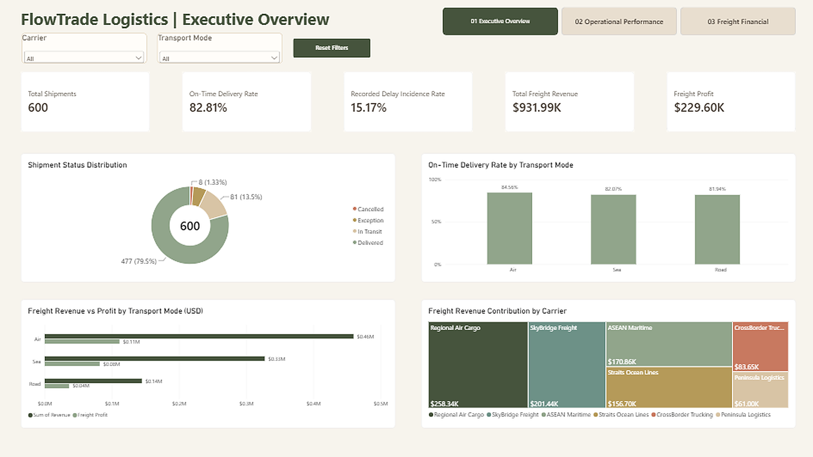
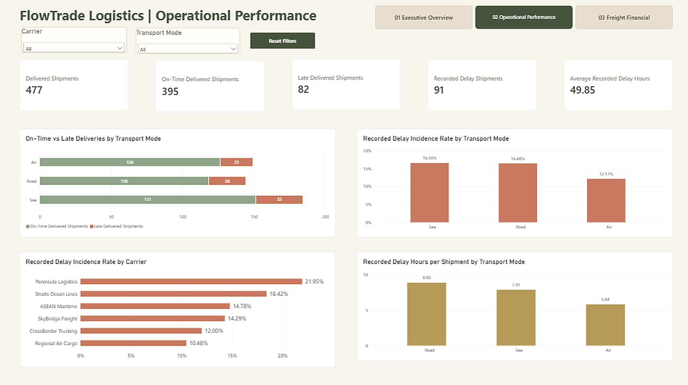
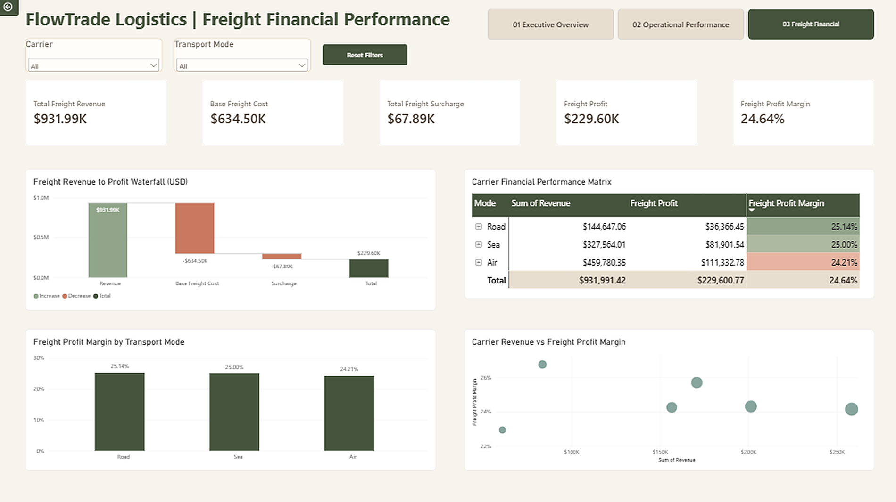

# 🚚 FlowTrade Logistics | Power BI Analytics Dashboard

> **A logistics-inspired business intelligence portfolio project exploring shipment reliability, operational delays, and freight profitability.**

**Tools:** Microsoft Power BI Desktop · DAX · Data Modelling · Interactive Data Visualisation  
**Data:** Synthetic / simulated freight-forwarding data  
**Report:** Three interactive dashboard pages  
**Currency:** USD

---

## 🎯 Project Overview

FlowTrade Logistics is an independent Power BI project **inspired by my professional exposure to operational workflows and data-driven processes at work**. That experience motivated me to explore how data visualisation can support freight-forwarding and logistics decisions through a self-directed portfolio project.

The scenarios, data, and reporting design were developed independently for learning and demonstration; they do not reproduce any employer systems, internal reports, or confidential information.

The goal is to connect **shipment operations** with **financial performance**: Which transport modes deliver reliably? Which carriers have higher recorded delay incidence? How do revenue, freight costs, surcharges, and profit compare?

The dataset is entirely **synthetic** and does not contain real employer, customer, or shipment records.

## 🧩 Business Questions

1. What is the overall shipment status distribution and on-time delivery performance?
2. How does delivery reliability vary by transport mode and carrier?
3. Where are recorded delay events more common, and how much delay time is recorded?
4. Which transport modes and carriers contribute the most revenue and profit?
5. How do base freight costs and surcharges reduce revenue to freight profit?

## 🗂️ Data Model

The analysis brings together four logical entities:

| Table | Purpose |
| :--- | :--- |
| **Shipments** | Shipment records, status, transport/carrier relationships, and delivery performance |
| **Carriers** | Carrier names and transport modes |
| **Delays** | Recorded delay events and delay hours |
| **FreightFinancials** | Shipment-level freight revenue, base cost, and surcharge |

The dataset contains **600 unique shipments**, **six carriers**, and **three transport modes** (Air, Road, Sea). Financial information covers 600 shipment records; the delay table contains **91 recorded delay events**.

Relationships and measures allow filtering by carrier and transport mode across operational and financial views.

## 📊 Dashboard Pages

### 01 · Executive Overview

A high-level view of logistics operations and freight financial performance.

**KPIs:** Total Shipments · On-Time Delivery Rate · Recorded Delay Incidence Rate · Total Freight Revenue · Freight Profit

**Visuals:**
- Shipment Status Distribution (donut)
- On-Time Delivery Rate by Transport Mode
- Freight Revenue vs Profit by Transport Mode
- Freight Revenue Contribution by Carrier (treemap)

### 02 · Operational Performance

A deeper examination of delivered shipments and recorded delay patterns.

**KPIs:** Delivered Shipments · On-Time Delivered Shipments · Late Delivered Shipments · Recorded Delay Shipments · Average Recorded Delay Hours

**Visuals:**
- On-Time vs Late Deliveries by Transport Mode (with carrier-level hierarchy)
- Recorded Delay Incidence Rate by Transport Mode
- Recorded Delay Incidence Rate by Carrier
- Recorded Delay Hours per Shipment by Transport Mode

### 03 · Freight Financial Performance

A financial view connecting revenue, freight costs, surcharges, and profit.

**KPIs:** Total Freight Revenue · Base Freight Cost · Total Freight Surcharge · Freight Profit · Freight Profit Margin

**Visuals:**
- Freight Revenue to Profit Waterfall
- Carrier Financial Performance Matrix
- Freight Profit Margin by Transport Mode
- Carrier Revenue vs Freight Profit Margin (scatter)

### 🖼️ Dashboard Screenshots

The screenshots below preview the three Power BI report pages using the full, unfiltered synthetic dataset.

**01 · Executive Overview**

**02 · Operational Performance**

**03 · Freight Financial Performance**

---

## 📐 KPI Definitions

| Measure | Definition |
| :--- | :--- |
| **On-Time Delivery Rate** | On-time delivered shipments ÷ all delivered shipments |
| **Late Delivery Rate** | Late delivered shipments ÷ all delivered shipments |
| **Recorded Delay Incidence Rate** | Shipments with a recorded delay event ÷ all shipments |
| **Average Recorded Delay Hours** | Total recorded delay hours ÷ number of recorded delay events |
| **Recorded Delay Hours per Shipment** | Total recorded delay hours ÷ all shipments |
| **Freight Profit** | Freight Revenue − Base Freight Cost − Surcharge |
| **Freight Profit Margin** | Freight Profit ÷ Freight Revenue |

**Important interpretation:** A shipment classified as *late delivered* is not necessarily the same as a shipment with a *recorded delay event*. These measures have different definitions and denominators. Likewise, movement-duration milestones should not be interpreted as delay hours.

## 📈 Validated Results

### Overall operational and financial metrics

| Metric | Result |
| :--- | ---: |
| Total Shipments | 600 |
| Delivered | 477 |
| In Transit | 81 |
| Exception | 34 |
| Cancelled | 8 |
| On-Time Delivered | 395 |
| Late Delivered | 82 |
| On-Time Delivery Rate | **82.81%** |
| Recorded Delay Events / Affected Shipments | 91 |
| Recorded Delay Incidence Rate | **15.17%** |
| Total Recorded Delay Hours | 4,536 |
| Average Recorded Delay Hours | 49.85 |
| Freight Revenue | **$931,991.42** |
| Base Freight Cost | $634,504.06 |
| Freight Surcharge | $67,886.59 |
| Freight Profit | **$229,600.77** |
| Freight Profit Margin | **24.64%** |

### Performance by transport mode

| Mode | Shipments | On-Time Delivery Rate | Recorded Delay Incidence | Freight Revenue | Freight Profit Margin |
| :--- | ---: | ---: | ---: | ---: | ---: |
| Air | 189 | 84.56% | 12.17% | $459,780.35 | 24.21% |
| Road | 182 | 81.94% | 16.48% | $144,647.06 | 25.14% |
| Sea | 229 | 82.07% | 16.59% | $327,564.01 | 25.00% |

### 💡 Observations

- **Air** has the highest on-time delivery rate (**84.56%**) and the lowest recorded delay incidence (**12.17%**) among the three modes in this synthetic dataset.
- **Road** has the highest recorded delay hours per shipment (**8.90 hours**), compared with Sea (**7.91**) and Air (**5.84**).
- **Peninsula Logistics** has the highest carrier-level recorded delay incidence (**21.95%**), while **Regional Air Cargo** has the lowest (**10.48%**).
- **Air** contributes the largest freight revenue (**$459,780.35**), while **Road** has the highest freight profit margin (**25.14%**).

These are **descriptive findings from simulated data**, not causal explanations or claims about real-world carrier performance. Differences may reflect the composition of the synthetic dataset rather than underlying operational drivers.

## 🖱️ Interactive Features

- Carrier and transport-mode dropdown slicers
- Slicer synchronisation across report pages
- Reset Filters controls
- Page navigation
- Visual cross-filtering
- Transport-mode and carrier hierarchy in the delivery-performance visual
- Conditional formatting for relative profit-margin comparisons
- Tooltips and carrier-level detail in financial visuals

## 🌿 Visual Design

The report uses a consistent earthy palette to help readers distinguish business concepts:

| Colour | Hex | Intended meaning |
| :--- | :--- | :--- |
| Deep Olive | `#46543D` | Primary headings, revenue comparisons, financial totals |
| Sage Green | `#91A58B` | On-time delivery and positive measures |
| Terracotta | `#C87960` | Late deliveries, recorded delays, and deductions |
| Muted Gold | `#B59A59` | Delay hours and secondary emphasis |
| Dusty Teal | `#6D9187` | Carrier comparisons |
| Cream | `#F7F4ED` | Report canvas background |

## ▶️ How to Explore

1. Download the Power BI report (`.pbix`) from this project folder **if the file has been uploaded**.
2. Open it in **Microsoft Power BI Desktop**.
3. Use the page navigation to move between Executive Overview, Operational Performance, and Freight Financial Performance.
4. Select a **Carrier** or **Transport Mode** to filter the report.
5. Use **Reset Filters** to restore the default slicer selection.
6. Explore chart selections, hierarchy expansion, and tooltips for additional detail.

**Note:** Screenshots provide a static preview; full interactivity requires the Power BI report file. Power BI Desktop may be required to open the `.pbix` file.

## 🧠 Skills Demonstrated

**Business intelligence:** KPI design, dashboard layout, chart selection, interactive reporting  
**Data modelling:** Relating shipment, carrier, delay, and financial entities  
**DAX:** Operational rates, delay measures, freight profit, and profit margin  
**Analytical reasoning:** Distinguishing event incidence from delivery outcomes; comparing operational reliability with commercial performance  
**Communication:** Translating calculated measures into readable business observations

---

## 📬 Portfolio

Return to the [main Data Science & Analytics Portfolio](../../README.md).

*Built as an independent learning and portfolio project using synthetic data.*
